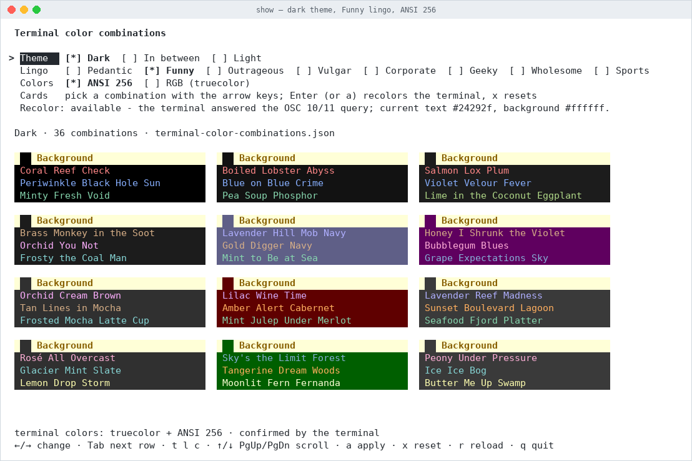
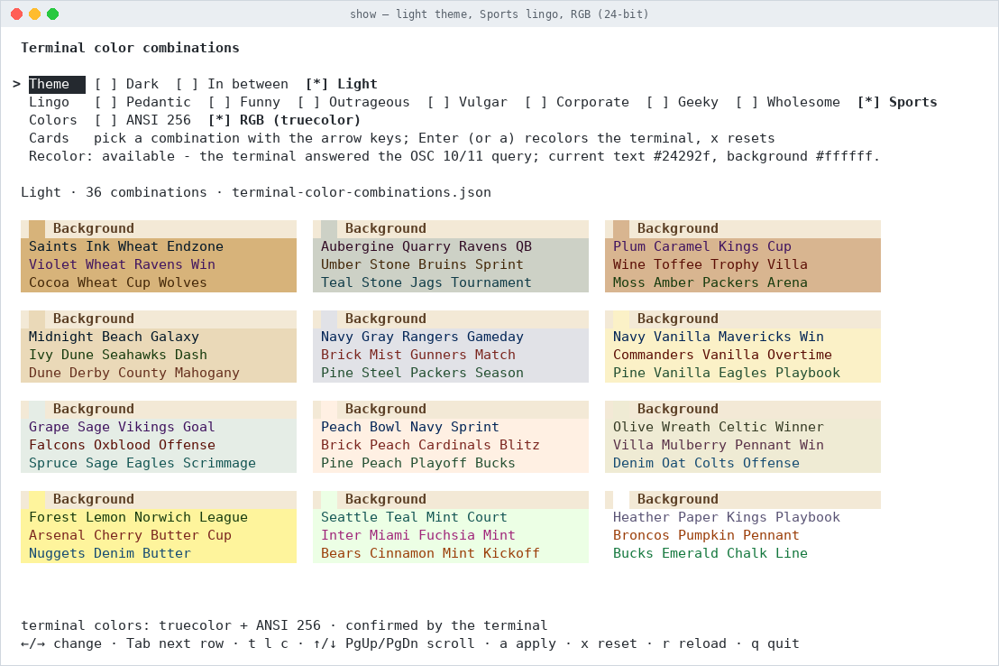
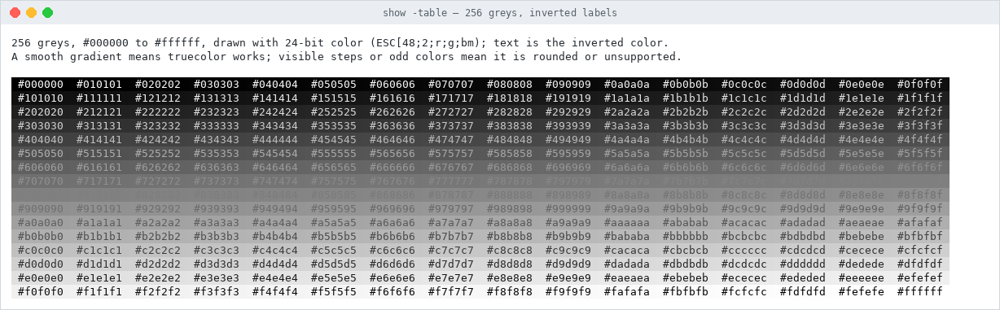
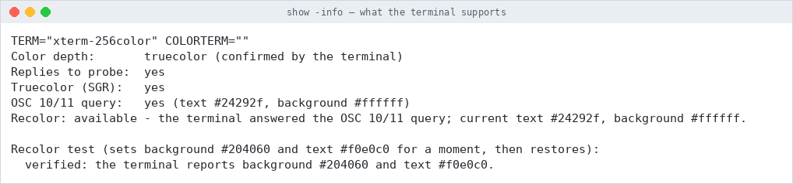
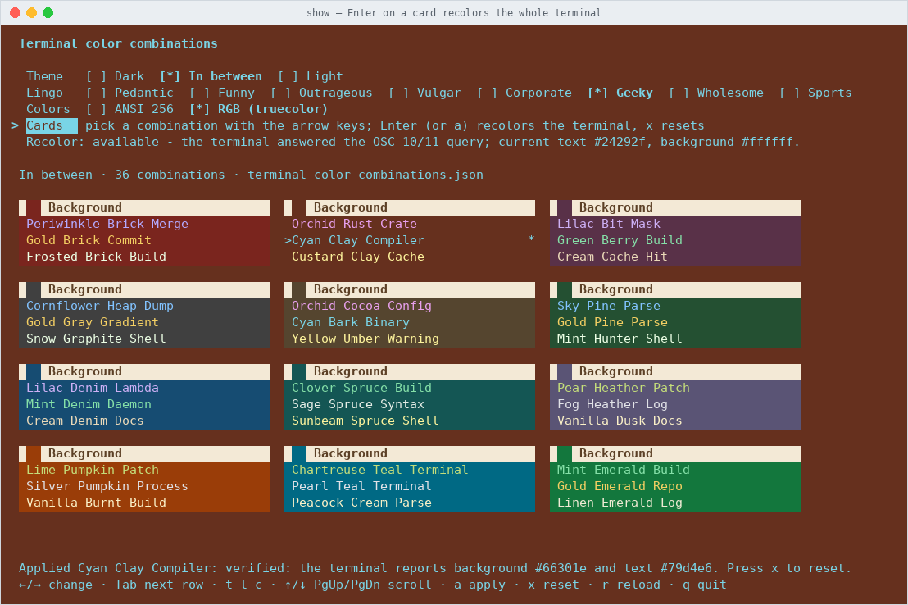

# show

**A terminal viewer for the [terminal color combinations](https://github.com/nontechno/color) palette**
(background + text color pairs, each with eight differently styled names), plus a few tools for finding out
what your terminal can really display.

Home and source of the project: **<https://github.com/nontechno/color>** &middot;
live web preview: <https://color.nontechno.com/> &middot;
palette: <https://color.nontechno.com/terminal-color-combinations.json>

`show` is a single Go program with no dependencies beyond the standard library. It runs on Windows
(Windows Terminal and the modern console), Linux, macOS and BSD.



## What it is for

The palette ([`terminal-color-combinations.json`](https://color.nontechno.com/terminal-color-combinations.json))
holds 108 background and text combinations that are readable and tasteful, each described both as `#rrggbb`
and as the nearest xterm-256 color index. `show` lets you look at them *in a real terminal*, where colors are
what matters, and answers practical questions:

- what does this combination look like in **my** terminal, as 256-color indexes and as exact RGB?
- which names does it have in each style (*Pedantic*, *Funny*, *Outrageous*, *Vulgar*, *Corporate*, *Geeky*, *Wholesome*, *Sports*)?
- does my terminal support truecolor, and can it be recolored from a program?

## What it does

- **Downloads** the palette from `https://color.nontechno.com/terminal-color-combinations.json`, validates every entry
  (theme, ranges, `#rrggbb`, non-empty names, `id == Text.ansi*256 + Background.ansi`) and skips invalid ones, counting them in the status line.
  A good download is cached; if a later download fails, the cached copy is used.
- **Selectors** for the **theme** (dark, in between, light), the **lingo** (naming style) and the **colors** (ANSI 256 or RGB).
- **Color cards**: one card per background, with its three text colors; each row shows the combination's name in its own colors.
  Cards are ordered by luminosity (lowest first) and flow into as many columns as the window allows. Names are never wrapped.
- **ANSI or RGB**: ANSI mode uses the xterm-256 indexes (`ESC[38;5;Nm` / `ESC[48;5;Nm`), RGB mode sends the exact
  `#rrggbb` as 24-bit colors (`ESC[38;2;r;g;bm` / `ESC[48;2;r;g;bm`). Flip between them to see how far the nearest index is from the real color.
- **Recolors the whole terminal** with a combination (see below).
- **Detects what the terminal supports** and says so on screen (see below).



## Install and run

```sh
go build -o show .        # Windows: go build -o show.exe .
./show
```

Your theme, lingo and color mode are remembered in your user config directory (`nontechno-color/show.json`).

### Keys

| Key | Action |
|---|---|
| `←` `→` | change the value of the focused row |
| `Tab` / `Shift+Tab` | move between Theme, Lingo, Colors and Cards |
| `t` `l` `c` | next theme / lingo / color mode |
| `1` `2` `3` | dark / in between / light |
| `↑` `↓` `PgUp` `PgDn` `Home` `End` (or `j` `k` `space` `b` `g` `G`) | scroll |
| `Enter` / `a` | on Cards (`a`: anywhere): recolor the terminal with the highlighted combination |
| `x` | restore the terminal's own colors |
| `r` | reload (also retries a failed download) |
| `q`, `Esc`, `Ctrl+C` | quit |

### Options

```
-url string      address of the palette JSON (default https://color.nontechno.com/terminal-color-combinations.json)
-file string     read the palette from a local file instead of downloading it
-theme string    initial theme: dark, between, light
-lingo string    initial lingo: Pedantic, Funny, Outrageous, Vulgar, Corporate, Geeky, Wholesome, Sports
-colors string   ansi (default) or rgb
-print           print the cards once and exit (also used when stdout is not a terminal)
-width int       width for -print and -table
-color           with -print: emit colors even when not writing to a terminal
-table           draw 256 grey cells (#000000..#ffffff) in 24-bit color and exit (truecolor test)
-info            report what this terminal supports and exit
-timeout dur     download timeout (default 15s)
```

## Does my terminal show `#rrggbb`?

`show -table` draws 256 cells whose backgrounds step from `#000000` to `#ffffff` in 24-bit color, each labelled with
its own value in the inverted color. A smooth gradient means the terminal shows exact RGB. Visible bands or repeated
cells mean it rounds to 256 colors; wrong colors or literal `←[48;2;...` text mean it does not understand the sequence
(on Windows use Windows Terminal, or a console with virtual terminal processing).



## What does my terminal support?

At startup the app asks the terminal directly instead of trusting `TERM`: it sets a 24-bit background and queries the SGR
state (DECRQSS), asks for the default text and background colors (`OSC 10` / `OSC 11`) and sends a device-attributes
request (DA1) last, so a silent terminal costs at most 250 ms. It also reads `NO_COLOR`, `COLORTERM`, `TERM` and
`WT_SESSION`. The findings are shown under the selectors and in the footer, and `show -info` prints them and exits:



On 8/16-color terminals the ANSI indexes are approximated with the nearest basic color; with `NO_COLOR` nothing is colored.
RGB mode can be switched on even when truecolor was not confirmed (a notice says so).

## Recolor the whole terminal

Besides drawing the cards, the app can change the terminal's own default colors with the exact `#rrggbb` values of a
combination: `OSC 11` sets the background and `OSC 10` the text color (`ESC ] 11 ; #rrggbb ESC \`).
Press `Tab` to the **Cards** row, highlight a combination and press `Enter` (or `a` from anywhere). The applied row is marked
with `*`. After applying, the app reads the colors back and reports `verified: ...` (or what it got instead). `x` restores the
terminal's colors, and so does quitting.



`show -info` also runs a short recolor test (sets `#204060` / `#f0e0c0`, reads them back, restores). Supported by Windows Terminal,
iTerm2, xterm, kitty, WezTerm, Alacritty, GNOME Terminal, Konsole and most others; not by the Linux virtual console or the legacy
Windows console host. tmux and screen may need passthrough. The recolor uses the RGB values even in ANSI mode, so it can differ
slightly from the card, which is drawn with the nearest xterm index.

## Source layout

| File | Purpose |
|---|---|
| `main.go` | flags, settings, event loop, `-print`, `-info`, `-table` |
| `data.go` | download, cache, validation, xterm palette, contrast, grouping and ordering |
| `colors.go` | color-depth detection, terminal probe, SGR and OSC sequences |
| `ui.go` | screen layout, selectors, cards, key handling |
| `term*.go` | raw mode, window size and input per platform (termios / Windows console VT) |
| `show_test.go` | tests (`go test ./...`), using `testdata/terminal-color-combinations.json` |

## Related

- Project home and sources: <https://github.com/nontechno/color>
- Usage of the JSON: <https://github.com/nontechno/color/blob/main/usage.md>
- Origins of the palette: <https://github.com/nontechno/color/blob/main/origins.md>
